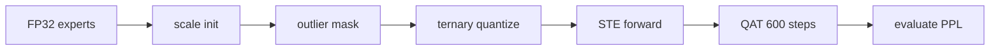

<p align="center">
  
</p>

# Ternary QAT for a 36M Mixtral MoE

A small, reproducible testbed for low-bit quantization-aware training (QAT) on a
Mixture-of-Experts language model. The model fits on a free Colab GPU, trains in
minutes, and exposes the parts that matter for larger MoE models: routed expert
quantization, learnable scales, outlier protection and mixed precision.

[](https://colab.research.google.com/github/ggarembroo/stories15m-moe-qat/blob/main/notebooks/stories15m_moe_qat_colab.ipynb)


## TL;DR

| Model | Params | Quantization | PPL |
|---|---:|---|---:|
| `stories15M_MOE` | 36M | FP32 | **16.20** |
| same | 36M | ternary PTQ | 3404.56 |
| same | 36M | ternary QAT, all params | 24.19 |
| same | 36M | ternary QAT + outlier + calibration + mixed precision | **21.49** |

Lower is better. PPL is measured on a held-out slice of TinyStories, 40 chunks of
128 tokens. This is a testbed, not a claim about 7B or 35B models.

The 2026-11-23 run includes the scale-gradient fix. The earlier 21.78 and 21.88
numbers trained weights but not the scales. See
[`docs/SCALE_GRADIENT_FIX.md`](docs/SCALE_GRADIENT_FIX.md) and
[`results/BEST_RUN_2026-11-23.md`](results/BEST_RUN_2026-11-23.md).

A matched FP32 control trained for the same 600 steps gives **19.56 PPL** over
three seeds, with 0.44 seed standard deviation. Ternary QAT gives **21.44 PPL**
over three seeds, with 0.16 seed standard deviation. The real QAT gap is about
**1.88 PPL**, not 5.3. See [`results/FP32_CONTROL.md`](results/FP32_CONTROL.md)
and [`results/SEED_VARIANCE.md`](results/SEED_VARIANCE.md).

The 2-bit outlier result 21.42 is inside the QAT seed noise. Do not treat it as
a real improvement.

Per-layer audit: layers 0 and 5 are the most sensitive, the middle layers less.
Quantization error is almost identical across layers, so the difference is a
depth effect, not an error-magnitude effect. See
[`results/LAYER_AUDIT.md`](results/LAYER_AUDIT.md).

## Why this model

`ggml-org/stories15M_MOE` is a Mixtral-style model with:

- 6 layers, hidden size 288
- 4 experts, top-2 routing
- FFN size 768
- 36M parameters

It is large enough to show the failure modes of post-training ternary
quantization, and small enough to iterate on a laptop or a free Colab T4.

## Results

| Variant | PPL | vs FP32 |
|---|---:|---:|
| FP32 baseline | 16.20 | 1.00x |
| Ternary PTQ, no training | 3404.56 | 210x |
| QAT experts only, fixed scales, 600 steps | 30.36 | 1.87x |
| QAT all params, fixed scales, 600 steps | 24.67 | 1.52x |
| QAT all params, learnable scales, 600 steps | 24.19 | 1.49x |
| QAT all params, learnable scales + block-32 Hadamard | 25.18 | 1.55x |
| QAT all params + outlier 0.1% + p99.9 calibration | 21.95 | 1.35x |
| same + layers 0 and 5 kept FP32 | **21.49** | **1.33x** |

The last row is the recommended recipe in this repo.

## Bit budget reality check

A 35B model in 6 GB needs **1.37 bits per weight** total.

| format | bpw | 35B size |
|---|---:|---:|
| binary + per-channel scales | ~1.00 | 4.4 GB |
| ternary, no group scales | 1.585 | 6.9 GB |
| ternary + group-32 FP16 scales | 2.08 | 9.1 GB |
| 2-bit + group-32 scales | 2.5 | 10.9 GB |

The current ternary group-32 recipe is **2.08 bpw**, which is 9.1 GB at 35B. It
does not fit 6 GB. The 36M testbed also keeps layers 0 and 5 in FP32, so its
effective rate is about 6.7 bpw. It is a method testbed, not a shipping format.

The 6 GB target needs binary experts or a different quantizer class, not more
tuning of ternary group scales.

## Scaling to OLMoE

The same QAT module works with `OlmoeExperts`. Full OLMoE-1B-7B QAT does not fit
a free Colab T4: 13.8 GB weights, 13.8 GB gradients and 55.3 GB Adam state are
about 83 GB before activations.

A 2-layer slice is **not** a valid language model and its PPL is meaningless.
It is only an architecture smoke test.

`olmoe_partial_qat.py` keeps all 16 layers and quantizes only selected layers.
That gives a valid PPL and fits 24 GB when two layers are selected. See
[`docs/OLMOE_QAT_PLAN.md`](docs/OLMOE_QAT_PLAN.md) for the memory math and the
80 GB / 4x H100 options.

## Pipeline



## Scale analysis

The 21.49 checkpoint was analyzed in
[`results/scale-analysis/`](results/scale-analysis/).

- no collapsed groups
- 85 to 87 percent of groups changed by less than 1 percent
- p90 change about 1.1 percent, max about 3.7 percent
- all layers moved by a similar amount
- outlier groups did not collapse or move more than the rest

The scales mostly shrank slightly. The gain comes from a small, uniform
adjustment, not from a few hot groups.

A 10x scale LR run moved the scales about ten times more but gave 21.53 PPL, so
the 1x value is kept. See [`results/SCALE_LR_SWEEP.md`](results/SCALE_LR_SWEEP.md).

## What the pipeline does

- **Ternary fake quantization** with a straight-through estimator.
- **Symmetric 2-bit / 4-bit** options for comparison.
- **Per-group scales**, optionally learnable.
- **Outlier protection**: keep the largest 0.1% of weights in FP32.
- **Calibration clipping**: initialize scales from the 99.9th percentile.
- **Mixed precision**: keep selected layers' experts in FP32.
- **Optional block-Hadamard rotation** before quantization.
- **Full-model or experts-only training**.
- Metrics and per-step history are written to `runs/<name>/`.

Only routed expert weights are quantized. Embeddings, attention, router and LM
head stay FP32.

## Quick start

### Google Colab

Open the notebook:

[`notebooks/stories15m_moe_qat_colab.ipynb`](notebooks/stories15m_moe_qat_colab.ipynb)

It installs dependencies, clones this repo, runs a short smoke test, then the
full 600-step recipe. A free T4 is enough.

### Local

```bash
git clone https://github.com/ggarembroo/stories15m-moe-qat.git
cd stories15m-moe-qat
python -m venv .venv
# Windows: .venv\Scripts\activate
# Linux/macOS: source .venv/bin/activate
pip install -r requirements.txt
```

Run the best-known recipe:

```bash
python train_qat.py --preset best
```

Quick smoke test:

```bash
python train_qat.py --preset best --steps 20 --batch-size 2
```

Evaluate FP32 only:

```bash
python train_qat.py --preset fp32 --steps 0
```

## Presets

| Preset | What it does |
|---|---|
| `best` | ternary, learnable group scales, outlier 0.1%, p99.9 calibration, layers 0 and 5 FP32, 600 steps |
| `ternary` | ternary, learnable group scales, no outlier, no mixed precision |
| `fp32` | no quantization, evaluation only |

## Outputs

```text
runs/best/
  qat_best.pt      # state dict
  metrics.json     # FP32, PTQ and post-QAT metrics
  history.csv      # step, loss, elapsed seconds
```

## Project structure

```text
qat.py                 # QAT expert module and replace_experts()
train_qat.py           # training/eval CLI for the 36M model
olmoe_slice_smoke.py   # OLMoE architecture smoke test, not a valid LM
olmoe_partial_qat.py   # valid partial-layer QAT, all 16 layers in forward
notebooks/             # Colab notebook
docs/                  # OLMoE plan and notes
results/QAT_RESULTS.md # raw experiment notes
results/BEST_RUN_2026-11-23.md # reproduced best run
```

## Caveats

- 36M is a toy. The absolute PPL and the optimal recipe may differ at 1B+.
- The Hadamard option here is block-32, not a full-width learned transform.
- Only 2 MB of training text and 600 steps. Longer training or more data may
  change the ranking of variants.
- The FP32 baseline in `metrics.json` is computed on the same held-out chunks as
  the quantized model, so the comparison is apples-to-apples.
- This repo does not include the 35B-A3B experiments. It is the small testbed
  used to choose the QAT recipe.

## License

MIT. See [LICENSE](LICENSE).
