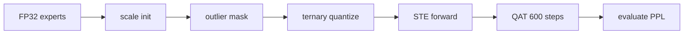

# Ternary QAT for a 36M Mixtral MoE

A small, reproducible testbed for low-bit quantization-aware training (QAT) on a
Mixture-of-Experts language model. The model fits on a free Colab GPU, trains in
minutes, and exposes the parts that matter for larger MoE models: routed expert
quantization, learnable scales, outlier protection and mixed precision.

[](https://colab.research.google.com/github/ggarembroo/stories15m-moe-qat/blob/main/notebooks/stories15m_moe_qat_colab.ipynb)


## TL;DR

| Model | Params | Quantization | PPL |
|---|---:|---|---:|
| `stories15M_MOE` | 36M | FP32 | **16.20** |
| same | 36M | ternary PTQ | 3404.56 |
| same | 36M | ternary QAT, all params | 24.19 |
| same | 36M | ternary QAT + outlier + calibration + mixed precision | **21.78** |

Lower is better. PPL is measured on a held-out slice of TinyStories, 40 chunks of
128 tokens. This is a testbed, not a claim about 7B or 35B models.

## Why this model

`ggml-org/stories15M_MOE` is a Mixtral-style model with:

- 6 layers, hidden size 288
- 4 experts, top-2 routing
- FFN size 768
- 36M parameters

It is large enough to show the failure modes of post-training ternary
quantization, and small enough to iterate on a laptop or a free Colab T4.

## Results

| Variant | PPL | vs FP32 |
|---|---:|---:|
| FP32 baseline | 16.20 | 1.00x |
| Ternary PTQ, no training | 3404.56 | 210x |
| QAT experts only, fixed scales, 600 steps | 30.36 | 1.87x |
| QAT all params, fixed scales, 600 steps | 24.67 | 1.52x |
| QAT all params, learnable scales, 600 steps | 24.19 | 1.49x |
| QAT all params, learnable scales + block-32 Hadamard | 25.18 | 1.55x |
| QAT all params + outlier 0.1% + p99.9 calibration | 21.95 | 1.35x |
| same + layers 0 and 5 kept FP32 | **21.78** | **1.34x** |

The last row is the recommended recipe in this repo.

## Pipeline



## What the pipeline does

- **Ternary fake quantization** with a straight-through estimator.
- **Symmetric 2-bit / 4-bit** options for comparison.
- **Per-group scales**, optionally learnable.
- **Outlier protection**: keep the largest 0.1% of weights in FP32.
- **Calibration clipping**: initialize scales from the 99.9th percentile.
- **Mixed precision**: keep selected layers' experts in FP32.
- **Optional block-Hadamard rotation** before quantization.
- **Full-model or experts-only training**.
- Metrics and per-step history are written to `runs/<name>/`.

Only routed expert weights are quantized. Embeddings, attention, router and LM
head stay FP32.

## Quick start

### Google Colab

Open the notebook:

[`notebooks/stories15m_moe_qat_colab.ipynb`](notebooks/stories15m_moe_qat_colab.ipynb)

It installs dependencies, clones this repo, runs a short smoke test, then the
full 600-step recipe. A free T4 is enough.

### Local

```bash
git clone https://github.com/ggarembroo/stories15m-moe-qat.git
cd stories15m-moe-qat
python -m venv .venv
# Windows: .venv\Scripts\activate
# Linux/macOS: source .venv/bin/activate
pip install -r requirements.txt
```

Run the best-known recipe:

```bash
python train_qat.py --preset best
```

Quick smoke test:

```bash
python train_qat.py --preset best --steps 20 --batch-size 2
```

Evaluate FP32 only:

```bash
python train_qat.py --preset fp32 --steps 0
```

## Presets

| Preset | What it does |
|---|---|
| `best` | ternary, learnable group scales, outlier 0.1%, p99.9 calibration, layers 0 and 5 FP32, 600 steps |
| `ternary` | ternary, learnable group scales, no outlier, no mixed precision |
| `fp32` | no quantization, evaluation only |

## Outputs

```text
runs/best/
  qat_best.pt      # state dict
  metrics.json     # FP32, PTQ and post-QAT metrics
  history.csv      # step, loss, elapsed seconds
```

## Project structure

```text
qat.py                 # QAT expert module and replace_experts()
train_qat.py           # training/eval CLI
notebooks/             # Colab notebook
results/QAT_RESULTS.md # raw experiment notes
```

## Caveats

- 36M is a toy. The absolute PPL and the optimal recipe may differ at 1B+.
- The Hadamard option here is block-32, not a full-width learned transform.
- Only 2 MB of training text and 600 steps. Longer training or more data may
  change the ranking of variants.
- The FP32 baseline in `metrics.json` is computed on the same held-out chunks as
  the quantized model, so the comparison is apples-to-apples.
- This repo does not include the 35B-A3B experiments. It is the small testbed
  used to choose the QAT recipe.

## License

MIT. See [LICENSE](LICENSE).
